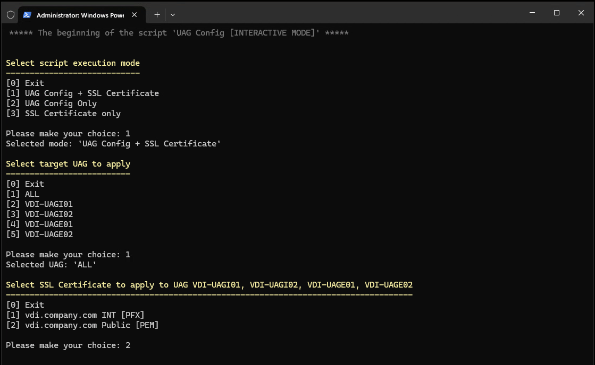
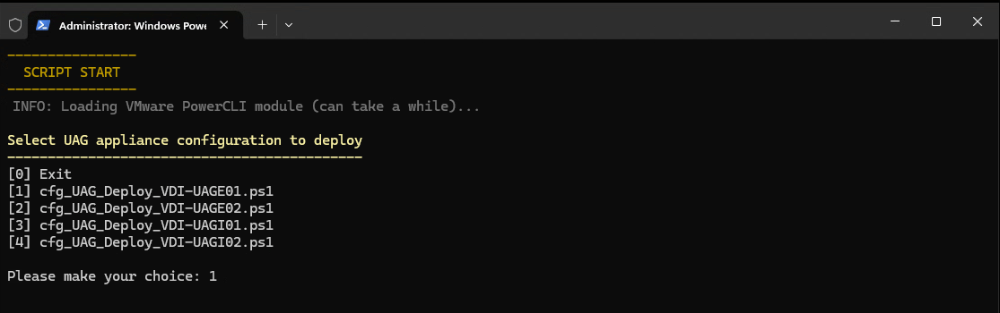

# Omnissa UAG Automation

**Deploy, configure and keep the certificates of Omnissa Unified Access Gateway (UAG) appliances up to date - with PowerShell and a few config files.**



## Why this exists

Running UAG in real life means doing the same things again and again:

* **Every UAG upgrade is a redeployment.** There is no in-place patching - you import a new OVA and configure it from scratch. Clicking through the admin UI for each appliance (and each customer) is slow and error-prone.
* **SSL certificates keep getting shorter.** Let's Encrypt is going from 90 days to 64 days (2027-02-10) and then to 45 days (2028-02-16). Renewing by hand does not scale.

These scripts turn both into a repeatable, reviewable, one-command job. Your whole UAG setup lives in plain-text configuration files you can keep in version control, and the scripts do the rest.

## What's inside

You only need to know three scripts. Each of them opens an **interactive menu when you run it without parameters** - parameters are for automation only.

| Script | Use it to |
| :---- | :---- |
| **`UAG_Config.ps1`** | Configure existing UAGs via REST API: system settings, Horizon Edge, SAML, RADIUS, Syslog, local users and SSL certificates - on one, several or all appliances at once |
| **`UAG_Deploy.ps1`** | Deploy a new UAG from the OVA into vSphere and configure it right away, ready for production |
| **`UAG_LetsEncryptCert.ps1`** | Get and renew a Let's Encrypt certificate and push it to your UAGs automatically |

```powershell
.\UAG_Config.ps1               # menu: what to configure, on which UAGs
.\UAG_Deploy.ps1               # menu: which appliance to deploy
.\UAG_LetsEncryptCert.ps1      # summary of the certificate + menu
```

## Highlights

* **Configuration as code** - inventory, certificates, baseline settings and per-appliance overrides are described once in `cfg_*.ps1` files. Same config, same result, every time.
* **From OVA to production in minutes** - native PowerCLI deployment (no OVF Tool), VM placement, power-on, waiting for the REST API and the full configuration afterwards.
* **Certificates on autopilot** - Posh-ACME + DNS-01 challenge, renewal only when due, deployment to the UAGs only after a renewal, e-mail report, scheduled task included. Active user sessions are preserved during certificate updates on current UAG versions (2606+).
* **Secrets stay out of your files** - passwords and shared secrets are stored encrypted with Windows DPAPI.
* **Checked before it runs** - the configuration is validated up front (`-ValidateOnly`), so mistakes show up before anything is deployed or changed.
* **Works unattended** - non-interactive detection, log files with transcript and retention, proper exit codes for Task Scheduler.

Validated on UAG 2512+. Requires PowerShell 5.1 or 7+ and TCP 9443 to the UAGs.



---

## Quick start

1. **Pick the example closest to your environment** and copy its `cfg_*.ps1` files next to the scripts:

   | Example | Scenario |
   | :---- | :---- |
   | [`Example1`](Example1) | **Basic - start here:** one UAG (one NIC), password authentication, one PFX certificate. No SAML, RADIUS or Let's Encrypt |
   | [`Example2`](Example2) | 2 internal + 2 external UAGs (one NIC), **SAML** (Entra ID) on the external ones, **Let's Encrypt** certificate |
   | [`Example3`](Example3) | 1 internal + 1 external UAG (one NIC), **RADIUS** MFA with a backup server, Syslog, NTP, **Let's Encrypt** certificate |
   | [`Example4`](Example4) | Two NICs, **RADIUS** MFA, plus a UAG on a **DR site in a different vCenter** |


2. **Replace every value in `<...>`** with your own. The scripts refuse to run until all placeholders are filled in (or removed).
3. **Check, then run.** Validate without touching anything, then apply:

   ```powershell
   .\UAG_Config.ps1 -Mode CfgConfigAndCert -TargetUAG ALL -CertName "vdi.company.com [PFX]" -ValidateOnly
   .\UAG_Config.ps1        # and choose what to apply from the menu
   ```

4. The first run asks for the passwords and secrets it needs and stores them encrypted with DPAPI (`sec_*.txt`). Next time it just runs.

> **DPAPI note:** the encrypted files can be read only by the same Windows account on the same computer. Run the scripts once interactively under the account that will run them later (e.g. the scheduled task account).

---

## The configuration files

| File | Read by | What it holds |
| :---- | :---- | :---- |
| `cfg_UAG.ps1` | `UAG_Config.ps1` | Inventory (`$UAG`), certificates (`$CERTS`), baseline for all UAGs (`$UAG_CFG["ALL"]`) and per-UAG overrides |
| `cfg_UAG_Deploy.ps1` | `UAG_Deploy.ps1` | Common deployment defaults: OVA repository, vSphere, network and UAG defaults |
| `cfg_UAG_Deploy_<UagName>.ps1` | `UAG_Deploy.ps1` | One appliance: name, IP addresses, port groups, power-on, post-deploy configuration. Only the keys that differ from the common file are needed - it can even override the vSphere target (a DR site in another vCenter) |
| `cfg_UAG_LetsEncryptCert.ps1` | `UAG_LetsEncryptCert.ps1` | Target UAGs, e-mail report, certificate and DNS provider |

<details>
<summary><b>Example: <code>cfg_UAG.ps1</code></b> (inventory, certificates, baseline, overrides)</summary>

```powershell
# Target appliances
$UAG = @(
    # Internal
    @{ Name = "VDI-UAGI01"; IP = "<10.0.10.11>"; User = "admin" }
    @{ Name = "VDI-UAGI02"; IP = "<10.0.10.12>"; User = "admin" }

    # External
    @{ Name = "VDI-UAGE01"; IP = "<10.0.10.21>"; User = "admin" }
    @{ Name = "VDI-UAGE02"; IP = "<10.0.10.22>"; User = "admin" }
)

# SSL certificates (PFX or PEM)
$CERTS = @{
    # Internal certificate (PFX)
    "vdi.company.com INT [PFX]" = @{
        CertType     = "PFX"
        CertPfxPath  = "C:\Install\Cert\vdi_company_com_int.pfx"
        CertPfxAlias = ""
        CertEntity   = @("end_user")
    }
    # Public Let's Encrypt certificate (PEM) issued by UAG_LetsEncryptCert.ps1
    "vdi.company.com Public [PEM]" = @{
        CertType   = "PEM"
        CertPem    = "<C:\Scripts\UAG-Automation\Posh-ACME\LE_PROD\1234567890\vdi.company.com\fullchain.cer>"
        CertKeyPem = "<C:\Scripts\UAG-Automation\Posh-ACME\LE_PROD\1234567890\vdi.company.com\cert.key>"
        CertEntity = @("end_user")
    }
}

# Baseline for all UAGs
$UAG_CFG = @{}
$UAG_CFG["ALL"] = @{
    systemSettings = @{
        dns         = "<10.0.1.10 10.0.1.11>"
        dnsSearch   = "<company.com>"
        ceipEnabled = $false
    }
    edgeService = @{
        enabled             = $true
        identifier          = "VIEW"
        proxyDestinationUrl = "<https://cs01.company.com>"
        blastExternalUrl    = "https://vdi.company.com:443"
        tunnelExternalUrl   = "https://vdi.company.com:443"
        trustedCertificates = @("<C:\Install\Cert\company_ca.cer>")
        authMethods         = "sp-auth"      # sp-auth | radius-auth | saml-auth | saml-auth,radius-auth
    }
    adminUsers = @{
        "monitoring" = @{
            name     = "monitor"
            password = ""                    # empty = stored securely via DPAPI
            enabled  = $true
            roles    = @("ROLE_MONITORING")
            userType = "INTERNAL"
        }
    }
}

# Per-appliance override: internal UAG
$uagName = "VDI-UAGI01"
$UAG_CFG[$uagName] = @{
    systemSettings = @{ uagName = $uagName }
    edgeService    = @{ gatewayLocation = "Internal" }
}

# Per-appliance override: external UAG with SAML authentication
$idpID   = "<EntraID_EntityID>"
$uagName = "VDI-UAGE01"
$UAG_CFG[$uagName] = @{
    systemSettings = @{ uagName = $uagName }
    edgeService    = @{
        gatewayLocation = "External"
        authMethods     = "saml-auth"
        idpEntityID     = $idpID
    }
    samlSettings = @{
        idpMetadataPath = "<C:\Install\UAG\saml_metadata.xml>"
        entityID        = $idpID
    }
}
```

</details>

#### How `cfg_UAG.ps1` works

* `$UAG` - inventory of the appliances (management IP address and admin user)
* `$CERTS` - SSL certificates (PFX or PEM) that can be uploaded to the UAGs
* `$UAG_CFG["ALL"]` - settings applied to every UAG
* `$UAG_CFG["<Name>"]` - settings of one UAG; they override (are merged into) `ALL`

Each section of `$UAG_CFG` is sent to its REST API endpoint:

| Section | REST API endpoint |
| :---- | :---- |
| `systemSettings` | `/rest/v1/config/system` |
| `uagSettings` | `/rest/v1/config/settings` |
| `edgeService` (Horizon) | `/rest/v1/config/edgeservice/view` |
| `samlSettings` | `/rest/v1/config/idp-ext-metadata` |
| `radiusSettings` | `/rest/v1/config/authmethod/radius-auth` |
| `syslogSettings` | `/rest/v1/config/syslog` |
| `adminUsers` | `/rest/v1/config/adminusers` |

**You are not limited to the settings shown in the examples.** The keys of a section are sent to the API as they are, so any property of that endpoint can be used. The full list with allowed values is in the [UAG REST API documentation](https://developer.omnissa.com/uag-rest-apis/getting-started-guide) and in the Swagger UI of your appliance (`https://<UAG-IP>:9443/swagger-ui/index.html`), where a `GET` of the endpoint also shows the exact property names of your UAG version.

#### How `cfg_UAG_Deploy*.ps1` work

The deployment is described in two layers: the common file `cfg_UAG_Deploy.ps1` holds the defaults for all appliances and `cfg_UAG_Deploy_<UagName>.ps1` describes one appliance. Keys of the appliance file override the same keys of the common file, so it is enough to list only what differs (for example the IP addresses and port groups - or a different vCenter for a DR site).

* `$UAG_OVA_Repo` - the OVA files by version; if no `uagVersion` is set, the latest one is used
* `$CFG_vSphere` - where to deploy: vCenter, cluster, host, datastore, folder, Resource Pool and the VM notes
* `$CFG_UAG` - the appliance itself. Most of its keys are **the properties of the UAG OVA** (deployment size, network and IP settings, root/admin passwords, SSH, password policy, ...): every key whose name matches a property of the OVA is passed to it, so any OVA property can be used. Only a few keys control the script: `uagName`, `uagVersion`, `UagPowerOn`, `UagAutoConfig` and `UagRestApiCfg` (which `UAG_Config.ps1` mode and certificate to apply after the boot)


---

## UAG_Config.ps1 - configure UAGs via REST API

Use it any time: to configure a freshly deployed UAG, to change a setting on all appliances, to switch authentication, or just to renew a certificate. Run it without parameters for the menu, or script it:

```powershell
# Configuration only - one UAG, a list of UAGs, or all of them
.\UAG_Config.ps1 -Mode CfgConfigOnly -TargetUAG "VDI-UAGE01"
.\UAG_Config.ps1 -Mode CfgConfigOnly -TargetUAG "VDI-UAGE01","VDI-UAGE02"
.\UAG_Config.ps1 -Mode CfgConfigAndCert -TargetUAG ALL -CertName "vdi.company.com [PFX]"

# Certificate only, straight from the command line (handy as an ACME renewal hook)
.\UAG_Config.ps1 -Mode CfgCertOnly -TargetUAG ALL -CertPem "C:\Certs\fullchain.cer" -CertKeyPem "C:\Certs\cert.key"
.\UAG_Config.ps1 -Mode CfgCertOnly -TargetUAG ALL -CertPfxPath "C:\Certs\vdi.pfx" -CertPfxPassword "SecretPass123"

# Check only: the UAG is not contacted and nothing is changed
.\UAG_Config.ps1 -Mode CfgConfigAndCert -TargetUAG ALL -CertName "vdi.company.com [PEM]" -ValidateOnly
```

<details>
<summary><b>Parameters</b></summary>

| Parameter | Type / values | Description |
| :---- | :---- | :---- |
| \-Mode | CfgConfigAndCert, CfgConfigOnly, CfgCertOnly | Scope: configuration, certificate, or both |
| \-TargetUAG | ALL, a name, or a list of names | Appliances from the `$UAG` inventory (an unknown name is an error) |
| \-UagCfg | File path | Configuration file (default `cfg_UAG.ps1`) |
| \-CertName | String | Certificate key from `$CERTS` |
| \-CertType | PEM, PFX | Certificate format for a dynamic upload |
| \-CertPem / \-CertKeyPem | File path | PEM full chain and RSA private key |
| \-CertPfxPath / \-CertPfxPassword / \-CertPfxAlias | File path / String | PFX file, its password (silent mode) and optional alias |
| \-CertEntity | end\_user, admin | Target listener (default `end_user`) |
| \-RadiusSecret / \-RadiusSecret2 | String | RADIUS shared secrets for non-interactive runs |
| \-AdminPassword | SecureString | UAG admin password supplied by a calling script (`UAG_Deploy.ps1`) |
| \-ValidateOnly | Switch | Validate only, without connecting to the UAG |
| \-ExpectedIP | String | Warn when the inventory IP differs from the expected management IP |

</details>

---

## UAG_Deploy.ps1 - from OVA to a configured UAG

Describe the appliance once, run the script, get a production-ready UAG:

```powershell
.\UAG_Deploy.ps1                          # menu with all cfg_UAG_Deploy_*.ps1 files
.\UAG_Deploy.ps1 -DeployCfg VDI-UAGE01    # one appliance (short name, file name or full path)
```

What happens:

1. The common (`cfg_UAG_Deploy.ps1`) and the appliance configuration are merged; passwords and placeholders are checked.
2. The REST API configuration is validated (`UAG_Config.ps1 -ValidateOnly`) *before* the VM is created.
3. The OVA is imported with PowerCLI; the VM is placed in the right folder, Resource Pool and datastore and gets its notes.
4. The VM is powered on and the script waits for the REST API (TCP 9443).
5. `UAG_Config.ps1` applies the baseline, Edge service, SAML/RADIUS, users and certificate.

Any failure ends the deployment, and vCenter is always disconnected. Requires VMware PowerCLI (`VMware.VimAutomation.Core`).

---

## UAG_LetsEncryptCert.ps1 - certificates on autopilot

The script obtains and renews a Let's Encrypt certificate with [Posh-ACME](https://poshac.me) and uploads it to the UAGs through `UAG_Config.ps1`. Domain ownership is proven with the **DNS-01 challenge**: the script temporarily creates a TXT record (`_acme-challenge.<domain>`) in your DNS zone through your DNS provider's API, so no UAG or web server has to be reachable from the internet, and wildcard certificates work too. Thanks to the wide range of Posh-ACME [DNS plugins](https://poshac.me/docs/latest/Plugins/) (Cloudflare, AWS Route 53, Azure, Google Cloud, GoDaddy and many more) it works with providers all over the world; extra plugins can simply be dropped into the `Plugins` folder.

```powershell
.\UAG_LetsEncryptCert.ps1                 # interactive: summary + menu
.\UAG_LetsEncryptCert.ps1 -Force          # unattended: renew when due, deploy after a renewal
.\UAG_LetsEncryptCert.ps1 -ForceDeploy    # deploy the current certificate even without a renewal
.\UAG_LetsEncryptCert.ps1 -TargetUAG "VDI-UAGE01","VDI-UAGE02" -Force
```

* The certificate is renewed only when it is due (Posh-ACME `RenewAfter`, about 2/3 of the lifetime), so a frequent schedule is harmless and leaves time for retries.
* It is uploaded to the UAGs **only after a new order or a renewal** (or with `-ForceDeploy`).
* `LE_STAGE` (the default in the examples) issues untrusted test certificates, which are **never** deployed unless you add `-AllowStageDeploy`. Switch `AcmeServer` to `LE_PROD` when you are ready.
* An e-mail report is sent also on failure; with `EmailOnlyOnEvent = $true` only after a renewal or an error.
* Exit code `0` on success and `1` on any error - Task Scheduler shows the real result.
* Posh-ACME data (account, orders, certificates, **private keys**) is kept in the `Posh-ACME` folder next to the script.

<details>
<summary><b>Example: <code>cfg_UAG_LetsEncryptCert.ps1</code></b></summary>

```powershell
$VAR = @{
    Company          = "<Company Name>"
    TargetUAG        = @("VDI-UAGE01", "VDI-UAGE02")   # "ALL" | one name | list of names
    LogDir           = "Logs"
    LogArchiveFiles  = 6
    SendEmail        = $true
    EmailOnlyOnEvent = $true                           # report only after a renewal or an error
    SmtpServer       = "<smtp.company.com>"
    SmtpPort         = "587"
    EmailFrom        = "Company VDI <vdi@company.com>"
    EmailTo          = @("<admin@company.com>")
}

$CERT = @{
    Name       = "<vdi.company.com>"
    Domain     = "<vdi.company.com>"                   # "host1","host2" or "*.domain.com","domain.com"
    Contact    = "<it@company.com>"
    AcmeServer = "LE_STAGE"                            # LE_STAGE = test | LE_PROD = production
}

# DNS provider for the DNS-01 challenge (any Posh-ACME DNS plugin)
$DNSAPI = @{
    PluginName      = "Cloudflare"
    SecretParamName = "CFToken"
    SecretType      = "SecureString"
    ExtraArgs       = @{}
}
```

</details>

### Running it on a schedule

`UAG_LetsEncryptCert_schtask.ps1` registers a Windows Scheduled Task that runs the script above with `-Force`. Run it once in an **elevated** PowerShell after setting the account and schedule in its `$VAR` block:

* **Account:** the current user (S4U), a service account (the password is asked for), or a gMSA (name ending with `$`, no password).
* **Schedule:** weekly (Friday 01:00) is recommended. With 64-day and later 45-day certificates the renewal window is only about 1/3 of the lifetime, so a weekly check leaves plenty of room for retries. Missed runs are started when possible and failed runs are retried.

The scheduled account must own the DPAPI secret files - run `UAG_LetsEncryptCert.ps1` once interactively under that account first (for a gMSA create them e.g. with PsExec). Tasks with the highest privileges create files owned by Administrators, so a later manual run needs an elevated PowerShell.

---

## Repository layout

```text
├── UAG_Config.ps1                    # REST API configuration & certificates
├── UAG_Deploy.ps1                    # vSphere OVA deployment & post-boot configuration
├── UAG_LetsEncryptCert.ps1           # Let's Encrypt issue/renew + deployment to UAGs
├── UAG_LetsEncryptCert_schtask.ps1   # Helper: creates the scheduled task
├── fce_UAG_Automation.ps1            # Shared functions (must be next to the scripts)
├── Example1/ ... Example4/           # Sample configuration sets
└── Images/                           # Screenshots used in this README
```

## Prerequisites

* PowerShell 5.1 or 7+ on Windows (DPAPI)
* TCP 9443 from the execution host to the UAG management interfaces
* VMware PowerCLI (`VMware.VimAutomation.Core`) - only for `UAG_Deploy.ps1`
* Posh-ACME and a DNS provider with an API - only for `UAG_LetsEncryptCert.ps1`

## Troubleshooting

<details>
<summary><b>The script stops with a "placeholder" error</b></summary>

A value in `<...>` is still present in a configuration file. Replace it with a real value or remove the key. Settings that you do not use must be removed or commented out.
</details>

<details>
<summary><b>DPAPI secret cannot be decrypted</b></summary>

`sec_*.txt` files are bound to the Windows account and the computer. When running under a scheduled task or another account, run the script interactively under that account to create valid files, or delete the file to reset the secret.
</details>

<details>
<summary><b>HTTP 401 / the admin account is locked</b></summary>

UAG locks the admin account after 3 failed logins, so the scripts never retry on 401. Delete the `sec_uag_*.txt` file, enter the correct password and wait for the unlock time.
</details>

<details>
<summary><b>HTTP 400 when creating a user (<code>adminUsers</code>)</b></summary>

The UAG REST API requires passwords with all 4 character classes and at least 8 characters. Avoid +, spaces, = and quotes - they are rejected by the UAG backend.
</details>

<details>
<summary><b>UAG management API unreachable (port 9443)</b></summary>

Allow TCP 9443 between the execution host and the UAG. After the first boot the REST API usually needs 1 to 3 minutes. If it works by IP but returns HTTP 400 by hostname, check the *Allow Host Header* property in `systemSettings`.
</details>

<details>
<summary><b>Let's Encrypt: the certificate was renewed but the UAG still has the old one</b></summary>

Check `TargetUAG` and the log in `Logs`. A STAGE certificate is deliberately not deployed (see `-AllowStageDeploy`).
</details>

## Security notes

* Secrets are encrypted with Windows DPAPI (computer + user) and are not kept in memory after the run.
* If you keep your own configuration in Git: do not commit `sec_*.txt`, `Logs` or the `Posh-ACME` folder (it holds private keys) - the provided `.gitignore` covers them.

## Resources

* UAG REST API Swagger UI on every appliance: `https://<UAG-IP>:9443/swagger-ui/index.html`
* [Omnissa UAG REST API documentation](https://developer.omnissa.com/uag-rest-apis/getting-started-guide)
* [Broadcom VMware PowerCLI](https://developer.broadcom.com/powercli)
* [Posh-ACME](https://poshac.me)

## Author & license

**Jan Fara** ([@jfacz](https://github.com/jfacz)) - released under the MIT license.
